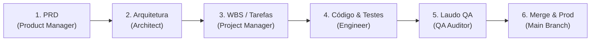

# .brain — Memória Compartilhada e Linha de Montagem de Software (.brain)

Este diretório centraliza a inteligência, a **bússola de objetivos e dores (Problem Space)**, o backlog e a **Linha de Montagem de Software (MetaGPT / SOPs)** do projeto **Sesi Cat**.

Ele foi desenhado para permitir que desenvolvedores, pesquisadores e múltiplos assistentes de IA (Antigravity/Gemini, Claude Code, Cursor, Hermes) colaborem sem deriva conversacional, com papéis especializados e contratos de dados estritos.

---

## 🏗️ Arquitetura de Pastas e Governança

```text
.brain/
├── README.md                      # Este guia de governança e operação
├── state.json                     # Estado em tempo real da esteira MetaGPT (Role, Fase, Tarefa)
├── ciclos.md                      # Sumário executivo dos ciclos de desenvolvimento ativos e concluídos
├── ciclos/                        # Pastas isoladas por ciclo de entrega (SOP MetaGPT)
│   ├── _template/                 # Templates canônicos (01_PRD, 02_ARCH, 03_TASKS, 04_QA_REPORT)
│   └── 2026-09-29_timeout_.../    # Exemplo real de ciclo completo com artefatos
├── objetivos.md                   # Bússola estratégica de valor (Dores, Ganhos, Anti-Escopos)
├── objetivos/                     # Arquivos detalhados de objetivos (OBJ-XX)
├── pendencias.md                  # Checklist e inventário do backlog ativo (PEND-XX)
├── pendencias/                    # Arquivos individuais de pendências
├── dialogo_ias.md                 # [Legado/Registro] Diário de bordo cronológico
└── scripts/
    └── manage_brain.py            # Automação CLI para SOPs, auditoria e sincronização
```

---

## 🚦 A Linha de Montagem MetaGPT (SOPs)

Em vez de longas conversas informais entre IAs, o projeto opera por **Linha de Montagem de Software**:



### Papéis e Responsabilidades (Roles)
1. **Product Manager (PM):** Consome a dor de negócio e elabora `01_PRD.md` (requisitos funcionais, user stories, critérios de aceite e limites de anti-escopo).
2. **Architect:** Consome o PRD e elabora `02_ARCH.md` (contratos de API, estrutura de schemas/DTOs, arquivos a alterar e diagramas de fluxo).
3. **Project Manager:** Consome a arquitetura e elabora `03_TASKS.json` (decomposição atômica de tarefas WBS, dependências e critérios de verificação).
4. **Engineer:** Consome sua tarefa específica e implementa o código na worktree cirúrgica, garantindo testes unitários locais.
5. **QA Auditor:** Executa suítes completas de validação (`unittest`, `node --check`, scripts de integridade) e emite `04_QA_REPORT.md`.

---

## 🧭 Guia Operacional para IAs e Desenvolvedores

### 1. Início de Turno (Check-in Obrigatório)
Ao iniciar uma sessão, execute no terminal:
```bash
python .brain/scripts/manage_brain.py sop status
```
*Ou consulte diretamente `.brain/state.json`.*
- Identifique o **Ciclo Ativo**, a **Fase Atual** e a **Role da Vez**.
- Assuma a persona designada para aquela fase e trabalhe estritamente no artefato correspondente.

### 2. Operação dos Comandos SOP
```bash
# Iniciar uma nova frente de trabalho / feature:
python .brain/scripts/manage_brain.py sop novo <slug> --titulo "Título da Demanda" --obj OBJ-01

# Atualizar o status de uma tarefa no WBS:
python .brain/scripts/manage_brain.py sop task TASK-01 DONE

# Avançar a esteira para a próxima fase (valida requisitos do artefato anterior):
python .brain/scripts/manage_brain.py sop avancar --nota "Requisitos validados"

# Recuar em caso de reprovação técnica ou falha de QA:
python .brain/scripts/manage_brain.py sop recuar --motivo "Falha no teste de regressão X"
```

### 3. Sincronização Obrigatória (Encerramento de Turno)
Ao finalizar qualquer alteração na pasta `.brain/`:
```bash
python .brain/scripts/manage_brain.py sync
```
Isso atualiza automaticamente `ciclos.md`, `objetivos.md` e `pendencias.md`.
