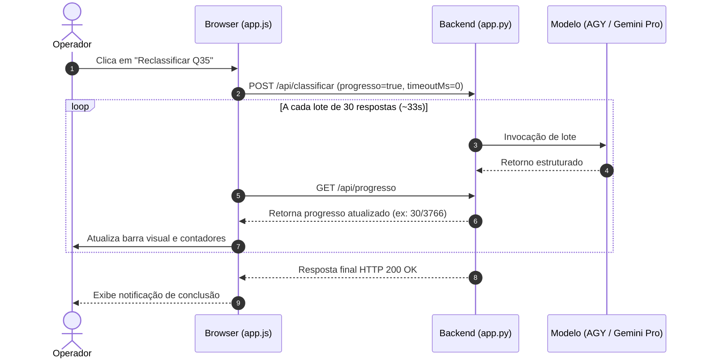

# Arquitetura & Contratos Técnicos: Gestão de Timeout e Progresso

## 1. Módulos e Arquivos Impactados
| Módulo / Arquivo | Ação | Responsabilidade |
| :--- | :---: | :--- |
| `tabulador/static/app.js` | Modificar | Tratar condicionalmente timeout para operações assíncronas com barra de progresso |
| `tabulador/src/llm.py` | Modificar | Elevar timeout do client OpenAI para acomodar lotes pesados |

## 2. Contratos & Assinaturas
### Frontend (`static/app.js`)
```javascript
// Contrato de timeout na função api()
const timeoutMs = opts.timeout ?? (progresso ? 0 : 240000);
// Quando timeoutMs === 0, não registrar setTimeout no AbortController
```

### Backend (`src/llm.py`)
```python
# Timeout configurável com fallback para 240 segundos
timeout = int(os.getenv("TABULADOR_LLM_TIMEOUT", "240"))
```

## 3. Diagrama de Sequência

