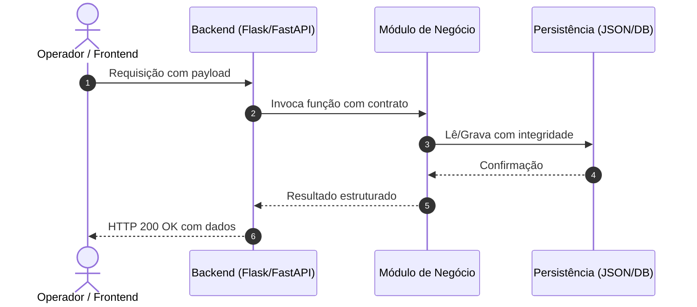

# Arquitetura & Contratos Técnicos: Estabilidade de IA, Volumetria, Ergonomia e Métricas (Feedbacks Sara 30/09)

## 1. Módulos e Arquivos Impactados
| Módulo / Arquivo | Ação | Responsabilidade |
| :--- | :---: | :--- |
| `caminho/do/arquivo_1.py` | Modificar | Implementação da lógica principal |
| `caminho/do/arquivo_2.js` | Modificar | Adaptação de chamadas frontend |
| `tests/test_arquivo_1.py` | Criar | Cobertura de testes unitários |

## 2. Estrutura de Dados & Schemas (Contratos)
> **Defina aqui a forma exata dos dados trocados entre módulos ou camadas para que o Engenheiro não precise adivinhar.**

```python
# Exemplo de Contrato de Dados / DTO
from typing import TypedDict, List

class ItemPayload(TypedDict):
    id: str
    nome: str
    status: str
```

## 3. Assinaturas de Funções & Endpoints
> **Contrato estrito de interfaces:**

### Backend
- **Função:** `processar_dados(origem: Path, limite: int = 100) -> ResultadoDTO`
  - **Parâmetros:**
    - `origem` (Path): caminho do arquivo de entrada.
    - `limite` (int): teto máximo de registros a processar por lote.
  - **Retorno:** Instância de `ResultadoDTO` contendo status e contadores.
  - **Exceções:** Lança `ValueError` se a base estiver vazia.

### API / Rotas
- **Endpoint:** `POST /api/exemplo`
  - **Request Body:** `{"param1": "valor", "limite": 50}`
  - **Response 200:** `{"status": "ok", "processados": 50}`
  - **Response 400/500:** `{"erro": "descricao"}`

## 4. Diagrama de Fluxo / Sequência


## 5. Estratégia de Isolamento Git (Regra Zero)
- **Worktree dedicada recomendada:** `jumppi/worktrees/2026-09-30_feedbacks_sara`
- **Branch base:** `feat/2026-09-30_feedbacks_sara` (ou `fix/2026-09-30_feedbacks_sara`)
- **Arquivos protegidos:** Jamais alterar diretórios de dados brutos (`data/`, `bases/`).
