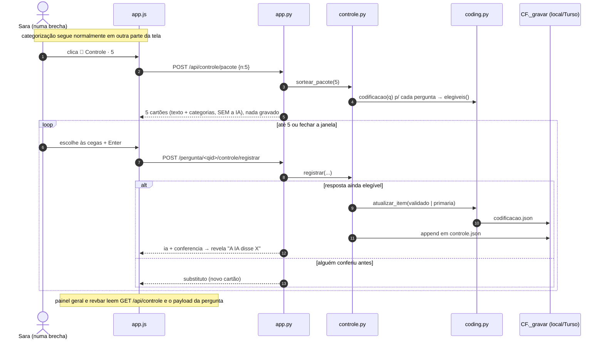

# Arquitetura & Contratos Técnicos: Controle de qualidade contínuo

> **Revisão 01/10:** a amostra fixa por pergunta foi trocada por **pacotes esporádicos sorteados na hora** (ver PRD). O sorteio passou a ser feito na hora, para o projeto inteiro, e a estimativa passou a acumular as conferências.

## 0. Pré-requisito bloqueante
A worktree deste ciclo precisa nascer **depois** do commit da PEND-22. Hoje, `aprendizado.py`, `historico.py` e o `app.js` novo estão sem commit, e uma worktree criada antes nasceria sem eles.

## 1. Módulos e Arquivos Impactados
| Módulo / Arquivo | Ação | Responsabilidade |
| :--- | :---: | :--- |
| `tabulador/src/controle.py` | **Criar** | População elegível, sorteio de pacote (projeto ou pergunta), registro da conferência, estimativas (pergunta, projeto, por estrato) e Wilson. Sem IA e sem Flask. |
| `tabulador/src/config.py` | Modificar | `CONTROLE_PACOTE=5`, `CONTROLE_MIN_DESTAQUE=30`, `CONTROLE_TETO_ERRO_AUTO=0.05` (env `TABULADOR_CONTROLE_*`) |
| `tabulador/src/coding.py` | Sem mudança de lógica | O controle reusa `atualizar_item()` para confirmar/corrigir. O campo `acerto_ia` continua no JSON, e só o rótulo da UI muda. |
| `tabulador/app.py` | Modificar | 3 rotas (pacote, registrar, estimativa do projeto); `controle` resumido em `_payload_pergunta` e em `/api/status` |
| `tabulador/src/report.py` | Modificar | Linha metodológica no relatório da pergunta |
| `tabulador/templates/index.html` | Modificar | Lugar da pílula `🎯 Controle` no topo, ao lado de `#ia-status` |
| `tabulador/static/app.js` | Modificar | Pílula, janela de cartões cegos, bloco "Controle de qualidade" no painel geral, linha na revbar, confirmação de aprovar com o erro estimado (troca o `confirm()` nativo por `abrirJanela`) e rótulo novo do acerto (6 lugares: ~266, 415, 463, 611, 1162, 1581) |
| `tabulador/static/app.css` | Modificar | Cartão, teclas, pílula, bloco do painel |
| `tabulador/tests/test_controle.py` | **Criar** | População, sorteio reprodutível, registro aplicado na base, concorrência (já conferida → substituto), Wilson, combinação do projeto, cobertura |

## 2. Estrutura de Dados & Schemas (Contratos)

### Sorteio sem persistência prévia
O pacote **não é gravado no sorteio**, só cada conferência ou "pular" no momento do registro. Fechar a janela no meio não deixa resto. Para isso, o cartão carrega os metadados do sorteio, e o `registrar` os devolve.

### `controle.json` (por pergunta, via `CF._gravar`, que funciona local e na nuvem)
```python
from typing import TypedDict, Literal, Optional

Estrato = Literal["auto", "a_conferir"]

class Cat(TypedDict):
    primaria: int
    secundaria: Optional[int]

class Sorteio(TypedDict):
    pacote: str                 # uuid curto do pacote
    semente: int
    em: str                     # ISO do sorteio
    origem: Literal["projeto", "pergunta"]   # pílula do topo × "conferir 5 desta pergunta" na aprovação
    populacao_pergunta: int     # N_q elegível no momento do sorteio
    populacao_projeto: int      # N elegível do projeto no momento (só quando origem = projeto)

class Conferencia(TypedDict):
    rid: int
    estrato: Estrato            # situação da resposta no momento do sorteio
    ia: dict                    # {primaria, secundaria, confianca, frame_versao, classificado_por?} no momento da conferência
    escolha_cega: Optional[Cat] # None quando a pessoa pulou
    final: Optional[Cat]
    pulada: bool
    erro: Optional[bool]        # final.primaria != ia.primaria
    erro_parcial: Optional[bool]
    sorteio: Sorteio
    por: str
    em: str

class Controle(TypedDict):
    versao: int                 # 1
    conferencias: list[Conferencia]
```

### Estimativas (saída de `controle.estimativa_pergunta` / `estimativa_projeto`)
```python
class Faixa(TypedDict):
    n: int; erros: int; p: Optional[float]; ic: Optional[tuple[float, float]]

class EstPergunta(TypedDict):
    qid: str
    populacao_atual: int                     # N_q elegível agora
    geral: Faixa                             # todas as conferências (não puladas)
    por_estrato: dict[Estrato, Faixa]
    erro_parcial: int; puladas: int
    destaque: bool                           # geral.n >= CONTROLE_MIN_DESTAQUE
    periodo: Optional[tuple[str, str]]       # primeira e última conferência
    anterior_ao_quadro: bool                 # maioria com frame_versao < versão atual

class EstProjeto(TypedDict):
    combinado: Faixa                         # combinação ponderada das perguntas com n>=1
    cobertura: float                         # fração da população elegível que está em perguntas com medida
    auto: Faixa                              # estrato 'auto' somado no projeto (calibração do limiar)
    alerta_auto: bool                        # limite INFERIOR do IC de auto > CONTROLE_TETO_ERRO_AUTO
    perguntas: list[EstPergunta]
```

### Estatística (contrato numérico, coberto por teste)
- **Elegível (população):**
  - classificada pela IA (`origem in ("llm", "llm+comentario")`), com `primaria` definida;
  - e sem decisão humana: `validado_por != "humano"` e `origem != "humano"`;
  - entram as automáticas (`validado_por == "auto"`) e as "a conferir";
  - ficam fora `regra`, `erro` e não classificadas.
- **Sorteio do pacote (origem = projeto):**
  - uniforme sem reposição sobre a **união** das elegíveis do projeto, com `random.Random(semente).sample(sorted(pares (qid, rid)), n)`;
  - cada resposta elegível tem a mesma chance, então perguntas grandes aparecem mais, na proporção certa.
- **Sorteio na aprovação (origem = pergunta):** uniforme sobre as elegíveis da pergunta.
- **Por pergunta:**
  - `p_q = erros_q / n_q` (sem as puladas), com Wilson 95% (`z = 1.96`);
  - sem destaque enquanto `n_q < CONTROLE_MIN_DESTAQUE`.
- **Projeto (combinação por pergunta, robusta aos pacotes "origem = pergunta"):**
  - pesos: `W_q = N_q / Σ N_q`, somando só as perguntas com `n_q ≥ 1` (`N_q` = população atual);
  - ponto: `p̂ = Σ W_q · p_q`;
  - variância com Agresti-Coull por pergunta: `p̃_q = (k_q+2)/(n_q+4)` e `Var = Σ W_q² · p̃_q(1-p̃_q)/(n_q+4)`;
  - IC: `p̂ ± 1.96·√Var`, limitado a [0, 1];
  - `cobertura = Σ_{q medida} N_q / Σ_{todas} N_q`. A tela mostra "cobre 72% do que vai sem conferência".
- **Pergunta já toda conferida (`N_q = 0`):** sai da combinação, porque não há mais erro a estimar ali. As conferências antigas continuam no histórico e no relatório.

## 3. Assinaturas de Funções & Endpoints

### Backend: `src/controle.py`
- `elegiveis(cod: dict) -> dict[int, Estrato]`: rid → estrato.
- `sortear_pacote(n: int | None = None, qid: str | None = None, por: str = "", semente: int | None = None) -> dict`
  - `qid=None` → origem projeto; `qid` informado → origem pergunta;
  - devolve `{"pacote": {id, semente, em, origem}, "cartoes": [Cartao]}`, sem gravar nada;
  - `Cartao = {qid, rid, texto, n_pessoas, enunciado, categorias: [{codigo, nome, definicao}], sorteio: Sorteio}`, **sem** `ia` (cego garantido no servidor);
  - população vazia → `cartoes: []` e `motivo: "nada sem conferência"`.
- `registrar(qid, rid, sorteio: Sorteio, final: Cat | None, escolha_cega: Cat | None, pular: bool, por: str) -> dict`
  1. relê a `codificacao`. Se a resposta **deixou de ser elegível** (outra pessoa conferiu nesse meio-tempo), não grava e devolve `{"substituto": Cartao}`, sorteado com a mesma origem;
  2. captura `ia` atual;
  3. se não pulou, aplica via `CD.atualizar_item` (`validado=True` se `final == ia`; senão `primaria`/`secundaria`);
  4. faz append em `controle.json`;
  5. devolve `{conferencia, ia}`. É o único ponto em que a `ia` vai para a tela, para a revelação.
- `estimativa_pergunta(qid) -> EstPergunta`
- `estimativa_projeto() -> EstProjeto` (lê todas as perguntas com codificação; < 300 ms)
- `wilson(k: int, n: int, z: float = 1.96) -> tuple[float, float]`

### API / Rotas (`app.py`; escrita sob `_lock`, como as demais)
- `POST /api/controle/pacote`
  - body `{"n": 5}` ou `{"n": 5, "qid": "Q35"}`;
  - 200 → `{pacote, cartoes, motivo?}`.
- `POST /api/pergunta/<qid>/controle/registrar`
  - body `{"rid": 123, "sorteio": {...}, "escolha_cega": {"primaria": 3, "secundaria": null}, "final": {...}}`, ou `{"rid": 123, "sorteio": {...}, "pular": true}`;
  - 200 → `{conferencia, ia}` | `{substituto}`.
- `GET /api/controle` → `EstProjeto`.
- `_payload_pergunta` ganha `"controle": controle.estimativa_pergunta(qid) if cod else None`, e `/api/status` ganha `"controle": {"elegiveis": N}` (para mostrar ou esconder a pílula).
- `por` vem do cabeçalho `X-Tabulador-Usuario`, como hoje.

### Frontend: os 3 lugares (`static/app.js`)
1. **Pílula no topo** (`templates/index.html`, ao lado de `#ia-status`): `🎯 Controle · 5 (~2 min)`.
   - Aparece só com `elegiveis > 0`.
   - É estática (sem animação, contador ou cobrança).
   - Clique → `POST /api/controle/pacote` → janela de cartões.
2. **Janela de cartões** (`abrirJanela`, no mesmo padrão das outras):
   - mostra enunciado da pergunta, texto e nº de pessoas;
   - lista de categorias com atalhos (1-9, letras), `S` para secundária, `P` para pular, `Enter` para confirmar;
   - revelação "A IA disse X" com `Manter a minha` / `A IA está certa`, e progresso "2 de 5";
   - fechar a qualquer momento; o que foi feito já está salvo;
   - ao fim: "Obrigado: 5 conferidas, 1 discordância", com link para o painel;
   - **não** chama `refresh()` da pergunta aberta (não mexe em filtros, rolagem nem operação em curso). Só invalida o resumo.
3. **Painel geral do projeto** (perto de `cabecalhoProjeto`), bloco "Controle de qualidade":
   - erro do projeto (ponto + IC + cobertura + período);
   - por pergunta: uma linha com n, ponto + IC ou "ainda pouco medido (k de ~30)";
   - automáticas × a conferir; e o aviso US-06 quando houver `alerta_auto`.
- **Na pergunta:**
  - a revbar ganha uma linha discreta "🎯 Erro estimado no que não foi conferido: 6% (2-15%) · 41 conferências" ou "ainda pouco medido";
  - o rótulo antigo vira "Acerto nas que vocês conferiram", com tooltip sobre o viés.
- **Aprovar (`bindAprovarBar`):**
  - o `confirm()` vira `abrirJanela` com o resumo de hoje + o erro estimado;
  - com `!destaque`: botões `Conferir 5 desta pergunta agora` (abre a janela de cartões com `qid`) e `Aprovar assim mesmo`.

### Relatório (`src/report.py`)
- Com conferências: "Controle de qualidade: erro estimado de X% (IC 95% a-b) nas N respostas entregues sem conferência humana, por amostragem aleatória contínua (n conferências às cegas entre DD/MM e DD/MM)."
- Abaixo do mínimo: o mesmo texto com "medida preliminar".
- Sem nenhuma: "Sem controle de qualidade por amostragem."

## 4. Diagrama de Fluxo / Sequência


## 5. Decisões de desenho
- **Sorteio na hora e sem gravar:** não há amostra para envelhecer nem resto quando a janela é fechada. A população acompanha a base sozinha (entrevistas novas entram no próximo sorteio).
- **Combinação por pergunta no projeto:** permite misturar os pacotes do topo (uniformes no projeto) com os da aprovação (só de uma pergunta) sem distorcer o número do projeto.
- **`controle.json` separado de `codificacao.json`:**
  - o estimador fica auditável;
  - o blob que já sofre com gravação simultânea não cresce (PEND-31);
  - apagar ou reabrir a codificação não destrói o histórico de controle.
- **Um único caminho de escrita na base (`atualizar_item`):** a correção feita no controle é idêntica à da tabela (`corrigido_de`, `revisado_por`, protegida em reclassificações).
- **Duas gravações por conferência, sem transação:** se `controle.json` falhar depois de a base ser corrigida, perde-se só a medida daquela conferência. A correção fica, e o erro é logado. Nunca o inverso.

## 6. Estratégia de Isolamento Git (Regra Zero)
- **Worktree:** `jumppi/worktrees/amostra_controle`, branch `feat/amostra_controle`, criada após a PEND-22.
- **Dados:** `SESI_cat/data/` e `SESI_cat/output*/` intocados. Os testes rodam com `TABULADOR_OUTPUT` temporário (`nuvem.ativa()` se desliga sozinho).
- **Commits sugeridos:**
  1. núcleo + testes;
  2. rotas;
  3. pílula + janela;
  4. painel, revbar e rótulo do acerto;
  5. aprovação;
  6. relatório.
