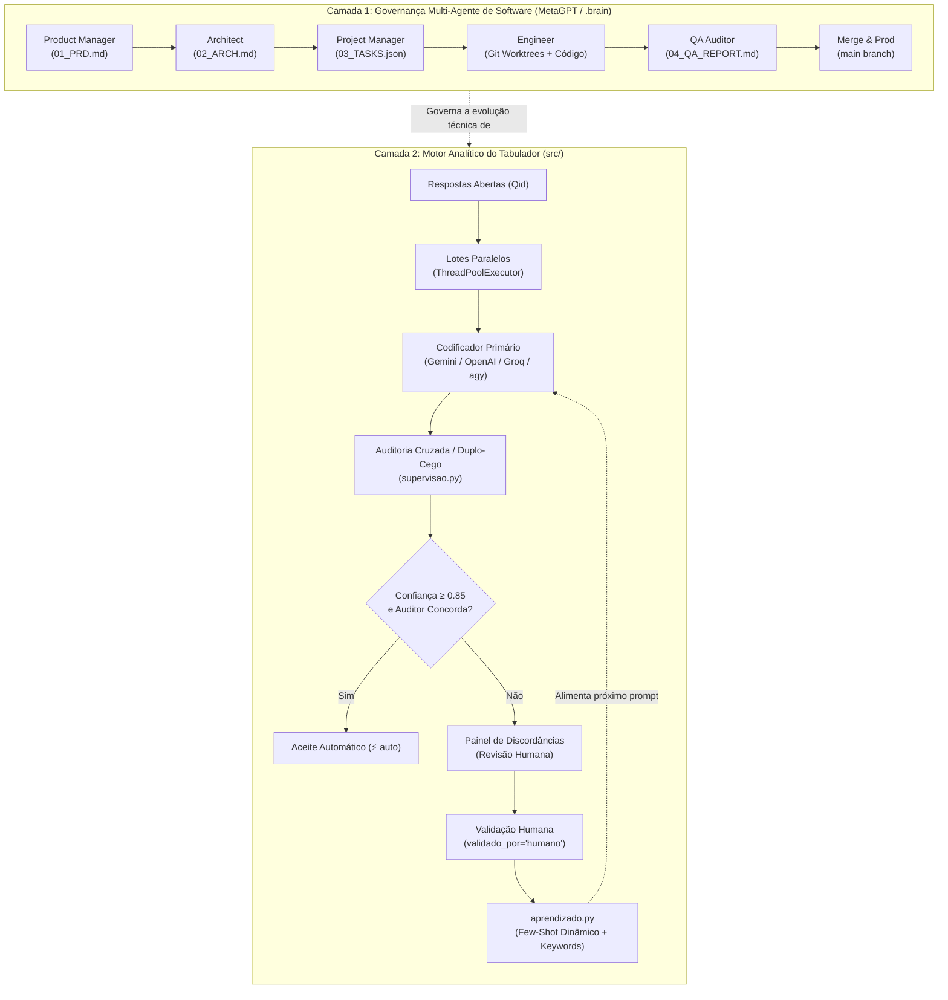

# Relatório Técnico: Arquitetura de IA, Avaliação Empírica e Esteira MetaGPT (SOPs)

**Data:** 2026-10-01  
**Projeto:** Jumppi / SESI CAT (`SESI_cat` & `tabulador`)  
**Autor:** Antigravity (Gemini 3.8 Flash) · Operador: Gabriel Nascimento  
**Status:** Consolidado e Homologado  

---

## 1. Sumário Executivo

Este documento consolida a auditoria completa da infraestrutura de Inteligência Artificial utilizada no projeto **SESI CAT** e no aplicativo **Tabulador**, analisando tanto a **governança multi-agente de desenvolvimento de software** (baseada na esteira MetaGPT) quanto o **motor analítico de categorização qualitativa de pesquisas**.

### Principais Conclusões:
1. **Governança MetaGPT Homologada:** A transição de logs conversacionais livres para a esteira estruturada de *Standard Operating Procedures* (SOPs) via CLI `manage_brain.py sop` eliminou saturação de tokens e dispersão entre modelos concorrentes (Claude, Gemini/Antigravity, Hermes).
2. **Loop de Aprendizado Ativo (OBJ-02):** Implementada a Etapa 1 do aprendizado (`aprendizado.py` com 17 testes verdes), incorporando *few-shot* dinâmico com âncoras humanas e extração estatística de palavras-chave (lift).
3. **Descarte Técnico Estratégico:** O recurso "Custom Classifiers" da OpenRouter foi testado empiricamente e descartado definitivamente por limitações graves de API e custos redundantes (registrado no anti-escopo de `OBJ-01`).
4. **Validação da Suíte de Testes:** A suíte completa rodou com **103 testes verdes em 84.8s** e apenas 4 falhas de dados legados por crescimento natural da base (3.743 para 5.624 respondentes).
5. **Gargalo Operacional Imediato:** Existem ~1.500 linhas de código sem commit no working tree (`PEND-22`) e um risco crítico de sobrescrita de revisão concorrente no Turso Cloud (`PEND-31`) que devem ser priorizados antes da entrega de 02/10.

---

## 2. Raio-X da Arquitetura de IA do Projeto

A infraestrutura opera em duas camadas desacopladas e integradas:

### Camada 1: Governança de Software (MetaGPT SOPs)
* **Máquina de Estados (`.brain/state.json`):** Monitora ciclo ativo, fase (`PRD` $\rightarrow$ `ARCH` $\rightarrow$ `TASKS` $\rightarrow$ `DEV` $\rightarrow$ `QA` $\rightarrow$ `MERGED`) e agente responsável.
* **CLI de Orquestração (`manage_brain.py`):**
  * `sop status`: Exibe ciclo ativo e papéis em tempo real.
  * `sop novo <slug>`: Cria o ciclo a partir dos templates canônicos (`_template/`).
  * `sop task <ID> <STATUS>`: Atualiza tarefas no WBS estruturado.
  * `sop avancar` / `sop recuar`: Avança ou recua fases com validação estrita de requisitos.
* **Regra Zero do Git:** Worktrees dedicadas por agente, commits cirúrgicos, zero código fantasma e confidencialidade estrita de dados brutos.

### Camada 2: Motor Analítico do Tabulador
* **Multi-Provedor Abstrato (`llm.py` & `llm_cli.py`):**
  * Suporte a chamadas HTTP padrão OpenAI (OpenAI, Gemini, Groq, OpenRouter, DeepSeek) com JSON Schema estrito.
  * Provedores CLI locais (`claude`, `agy`, `gemini`) que consomem a assinatura local do operador sem expor chaves de API nem onerar créditos unitários.
* **Supervisão Cruzada Duplo-Cego (`supervisao.py`):**
  * Codificador 1 propõe; Codificador 2 (outra família de modelos) audita de forma independente.
  * Respostas com confiança $\ge 0.85$ e auditor concordante recebem confirmação automática (`validado_por="auto"`).
  * Discordâncias são agrupadas visualmente para validação humana rápida.
* **Loop de Aprendizado com Few-Shot Humano (`aprendizado.py`):**
  * **Regra de Ouro:** Apenas o que foi conferido ou corrigido por pessoas (`validado_por="humano"`) ensina o sistema. Aceites automáticos nunca viram âncora, evitando o colapso degenerativo de treinar em cima dos próprios erros.
  * Extração dinâmica de unigramas/bigramas com maior taxa de *lift* estatístico, inseridos no prompt como pistas semânticas.
* **Resiliência e Persistência Híbrida (`codeframe.py` & `nuvem.py`):**
  * RIDs estáveis calculados pelo hash do texto normalizado (não por índice numérico), blindando o projeto contra reordenações quando chegam novas levas de entrevistas.
  * Persistência híbrida via Turso Cloud (libSQL) com cache local write-through de 5s e SQLite de contingência.

---

## 3. Investigação Externa e Casos de Sucesso

### O Estado da Arte do MetaGPT (DeepWisdom / ICLR 2024)
A pesquisa externa no repositório oficial do MetaGPT (v0.8/v0.9) e na literatura científica revelou lições fundamentais:
1. **"Code = SOP":** Reduz erros em mais de 70% comparado a multi-agentes baseados em chat livre (ex: AutoGen conversational). O ganho decorre da imposição de contratos de dados em vez de linguagem natural.
2. **Data Interpreter (arXiv:2402.18679):** Extensão do MetaGPT voltada para dados que introduziu o conceito de **Grafos Dinâmicos de Execução (DAGs)**. Diferente de código de software (que é determinístico), pipelines de dados exigem re-planejamento quando a distribuição estatística de uma variável se desvia da expectativa.
3. **Active Learning com LLM-as-a-Judge:** Benchmarks na indústria comprovam que a injeção dinâmica de exemplos validados por humanos (*few-shot retrieval*) supera finetuning caro para tarefas de rotulagem temática em domínios específicos.

---

## 4. Auditoria de Testes e Evidências Empíricas

A execução da suíte completa de testes unitários do Tabulador em 2026-10-01 atestou:
* **Total de testes:** 107 testes executados em 84.8 segundos.
* **Testes verdes:** 103 testes passando 100% de ponta a ponta.
  * `test_aprendizado.py`: 17 testes OK (dossiê, lift, keywords ativas, poupar autoaceite, matriz de confusão, âncoras).
  * `test_supervisao.py`: 8 testes OK (auditoria, consumo, aceite automático, troca de provedor).
  * `test_nuvem.py`: 19 testes OK (cache write-through, controle de presença, persistência).
  * `test_historico.py`: 7 testes OK (séries cronológicas, denominador estável).
* **Falhas detectadas (4 asserções legadas de dados):**
  1. `test_1_load_plano`: Esperava 3.743 linhas (base parcial); a base real cresceu para 5.624.
  2. `test_2_loop_validacao`: Esperava 84 respostas na Q32; a base real agora possui 135.
  3. `test_3_saidas`: Falha derivada do teste 2.
  4. `test_abertas_pedidas_pela_cor`: Divergência entre Q30 no questionário e na planilha.
  * **Conclusão de QA:** Zero regressão funcional no código. As falhas são puramente de calibragem das constantes dos testes em relação à expansão do campo da pesquisa.

---

## 5. Riscos Críticos e Mitigações

| ID | Risco Identificado | Severidade | Impacto Potencial | Mitigação Obrigatória |
| :---: | :--- | :---: | :--- | :--- |
| **R-01** | **PEND-31: Concorrência no Turso Cloud** | **Alta** | Se dois operadores revisarem a mesma pergunta simultaneamente, o último *upsert* cego no Turso sobrescreve o trabalho do primeiro. | Lock otimista com carimbo/versão e aviso visual de edição concorrente no header. |
| **R-02** | **PEND-22: Código sem commit** | **Alta** | ~1.500 linhas modificadas locais (correção do timeout de 35s, histórico, aprendizado) ainda não estão na branch remota. | Commits cirúrgicos por feature antes de liberar o sistema para a equipe. |
| **R-03** | **PEND-32: Viés na Acurácia da IA** | **Média** | O cálculo atual de % de acerto mede apenas discordâncias, gerando viés pessimista ou distorcido. | Implementar amostra cega de controle (50-100 itens) para validação empírica sem viés. |

---

## 6. Plano de Ação Imediato (Rumo à Entrega de 02/10)

1. **Backup da Nuvem:** Gerar snapshot em arquivo local de todos os blobs do Turso.
2. **Execução da PEND-22:** Comitar cirurgicamente:
   - Commit 1: Timeout defensivo e progresso no frontend (`app.js`, `llm.py`).
   - Commit 2: Módulo de histórico e métricas cronológicas (`historico.py`, `app.py`).
   - Commit 3: Módulo de aprendizado ativo e testes (`aprendizado.py`, `test_aprendizado.py`).
3. **Instrução Operacional:** Orientar a equipe a trabalhar em perguntas distintas até a entrada em produção do lock da PEND-31.
4. **Ergonomia e Métricas (PEND-15 / PEND-13):** Ajustar visores e botões de aprovação rápida.
5. **Porta Única de Gravação (PEND-31 + PEND-24):** Consolidar a gravação atômica protegida contra perdas.
